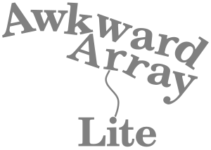

<!-- begin-logo -->

<!-- end-logo -->

[](https://www.python.org)
[](https://opensource.org/licenses/BSD-3-Clause)
[](https://github.com/CoffeaTeam/awkward-lite/actions/workflows/ci.yml)

Awkward Array Lite is a minimal, CPU-only fork of [Awkward Array](https://github.com/scikit-hep/awkward). It is an independent project, not affiliated with or endorsed by the authors of Awkward Array or by Scikit-HEP.

Awkward Array is a library for **nested, variable-sized data**, including arbitrary-length lists, records, mixed types, and missing data, using **NumPy-like idioms**.

Arrays are **dynamically typed**, but operations on them are **compiled and fast**. Their behavior coincides with NumPy when array dimensions are regular and generalizes when they're not.

# Motivating example

Given an array of lists of objects with `x`, `y` fields (with nested lists in the `y` field),

```python
import awkward as ak

array = ak.Array([
    [{"x": 1.1, "y": [1]}, {"x": 2.2, "y": [1, 2]}, {"x": 3.3, "y": [1, 2, 3]}],
    [],
    [{"x": 4.4, "y": [1, 2, 3, 4]}, {"x": 5.5, "y": [1, 2, 3, 4, 5]}]
])
```

the following slices out the `y` values, drops the first element from each inner list, and runs NumPy's `np.square` function on everything that is left:

```python
output = np.square(array["y", ..., 1:])
```

The result is

```python
[
    [[], [4], [4, 9]],
    [],
    [[4, 9, 16], [4, 9, 16, 25]]
]
```

The equivalent using only Python is

```python
output = []
for sublist in array:
    tmp1 = []
    for record in sublist:
        tmp2 = []
        for number in record["y"][1:]:
            tmp2.append(np.square(number))
        tmp1.append(tmp2)
    output.append(tmp1)
```

The expression using Awkward Arrays is more concise, using idioms familiar from NumPy, and it also has NumPy-like performance. For a similar problem 10 million times larger than the one above (single-threaded on a 2.2 GHz processor),

   * the Awkward Array one-liner takes **1.5 seconds** to run and uses **2.1 GB** of memory,
   * the equivalent using Python lists and dicts takes **140 seconds** to run and uses **22 GB** of memory.

Awkward Array is even faster when used in [Numba](https://numba.pydata.org/)'s JIT-compiled functions.

# Getting help

Report bugs and request features on this repository's [GitHub Issues](https://github.com/CoffeaTeam/awkward-lite/issues).

# Installation

Awkward Array Lite is installed from this repository with pip:

```bash
pip install git+https://github.com/CoffeaTeam/awkward-lite.git
```

This installs two packages, both built from this repository: `awkward`, which is pure Python, and `awkward-cpp`, the compiled components, which need a C++ compiler to build.

The packages are still named `awkward` and `awkward-cpp`, and the module is still imported with `import awkward as ak`, so that libraries built on them work unchanged. If an environment already has packages with those names from PyPI or conda-forge, uninstall them first, or start from a new environment.

<!-- readme-pypi-ignore-after -->

# Installation for developers

Clone this repository _recursively_ to get the header-only C++ dependencies, then generate sources with [nox](https://nox.thea.codes/), compile and install `awkward-cpp`, and finally install `awkward` as an editable installation:

```bash
git clone --recursive https://github.com/CoffeaTeam/awkward-lite.git
cd awkward-lite

python -m pip install -v ./awkward-cpp
python -m pip install -e .
```

Tests can be run in parallel with [pytest](https://docs.pytest.org/):

```bash
python -m pytest -n auto tests
```

For more details, see [CONTRIBUTING.md](CONTRIBUTING.md), or one of the links below.

   * [Continuous integration](https://github.com/CoffeaTeam/awkward-lite/actions/workflows/ci.yml) is hosted by [GitHub Actions](https://github.com/features/actions/).
   * The [LICENSE](LICENSE) is BSD-3.

# Documentation

This repository does not publish documentation. The interface is the same as that of the original Awkward Array, whose rendered documentation is at [awkward-array.org](https://awkward-array.org).

The documentation can also be built locally, as described in [CONTRIBUTING.md](CONTRIBUTING.md#building-documentation-locally).
